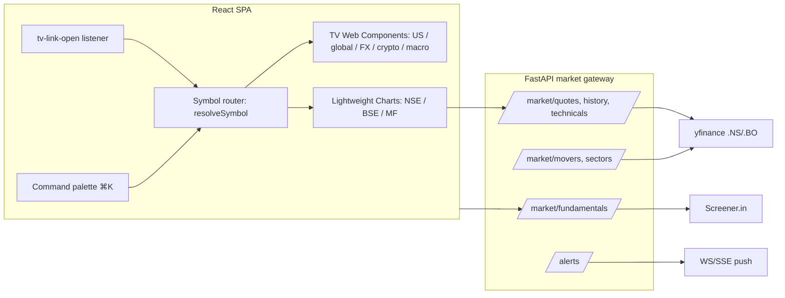

# NXTvue × TradingView: Premium Platform Plan

Status: **Draft for approval** · Source: live exploration of <https://www.tradingview.com/widget-docs/> plus a review of `apps/backend` and `apps/frontend/nxtvue-web`.

---

## 1. Live test findings (read first)

Web Components were mounted in a browser against the TradingView widget CDN (`tv-mini-chart`). The Web Component mechanics work. Indian symbols do not.

| Symbol | Result |
|---|---|
| `NASDAQ:NVDA` | Works (delayed, tagged "D") |
| `FX_IDC:USDINR` | Works (live) |
| `NSE:RELIANCE`, `NSE:NIFTY`, `NSE:GVT&D` | **"Permission denied: only available on TradingView"** |
| `BSE:RELIANCE`, `BSE:SENSEX` | **"Unsupported interval"** (docs list BSE as EOD only) |
| `BSE:522275` | Invalid symbol |

NSE appears in none of the six regional market lists in the docs ("Available markets").

### Impact on the earlier draft plan

| Draft assumption | Reality |
|---|---|
| `NSE:GVT_D` in the `/chart` page | NSE will not render in the free widgets. |
| Ticker tape with Nifty / Sensex | Not possible with TradingView. |
| Nifty 50 heatmap | Very likely not possible (heatmap and screener not tested directly). |
| `<tv-mini-chart>` sparkline per Indian holding | Blocked for NSE. BSE might work with a daily interval (unverified). |
| "Shared single data socket, zero memory bloat" | FAQ: Advanced Chart, Screener, Heatmap and Economic Calendar each embed a hosted iframe with their own data connection. |
| Technical Analysis pill per portfolio row | One iframe per row, and it will not work for NSE. Compute the signal in our backend. |

### TradingView limits (from the FAQ)

- US data is delayed and cannot be upgraded. Widgets cannot display our own data. There is no data API and no export.
- No Pine scripts or strategies in widgets.
- Closed shadow roots: only CSS tokens, `::part` selectors and the `theme` attribute can customise a widget.
- Removing attribution or branding requires contacting TradingView.

### Confirmed capabilities

- `tv-link-open` is dispatched on the widget and bubbles. `event.detail` is `{ href, context: { symbol, interval, widget } }`. Call `preventDefault()` to route inside the SPA.
- `symbol-url` attribute, `<tv-custom-settings>` and `window.TradingViewCustomWidgetSettings` redirect symbol links.
- Theming: `theme="dark|light"` or `color-scheme`, plus tokens such as `--tv-widget-background-color`, `--tv-widget-accent-color`, `--tv-widget-positive-color`, `--tv-widget-negative-color`, `--tv-widget-font-family`.
- Embedding: one module script plus a `tv-*` element. Attribute changes update in place (for example `symbol`, `interval` on Advanced Chart).

### Strategy: hybrid

- **TradingView widgets** where they have data: US, global indices, forex (including USDINR), crypto, commodities, macro calendar, news.
- **Our own India stack** for NSE/BSE: yfinance (`.NS` / `.BO`), Screener.in, mftool, INDmoney, FRED (all already in the backend).
- **Lightweight Charts™** (TradingView's open-source library, fed by our data) renders India charts.
- **Advanced Charts** (licensed library with a custom datafeed) is a later option, not part of this plan.

---

## 2. Current state of the app

- **Frontend:** React 19, Vite, Tailwind 4, framer-motion. No charting library; `ChartContainer.tsx` is hand-built.
- **Backend:** FastAPI with SSE streaming for analysis, `/api/v1/ws/indices`, and data layers in `tools/` (Screener.in, yfinance, MF, ETF, bonds, INDmoney MCP). Analyzers for risk, quant and portfolio. `/portfolio/intelligence`, PDF reports, `wealth_manager.py`.
- **Design split:** `DashboardPage.tsx` is a light `#F5F5F5` marketing-style page; nav and the rest of the app use the dark glass theme.
- **Dashboard copy:** includes "USD NxtVue is a reward-earning dollar coin" and a "Funded by premier partners" strip (Polychain, Chainlink and others). This is misleading for an institutional audience.
- **Websocket cost:** `/ws/indices` runs a 5-second yfinance loop per connected client.
- **Alerts:** the notification bell exists, but nothing triggers price alerts.

---

## 3. Target architecture

### Core building blocks (build once, reuse everywhere)

1. **`resolveSymbol(ticker, market)`** returns `{ engine: 'tv' | 'native', tvSymbol?, yahooSymbol }`. NSE/BSE map to `native`; everything else to `tv`. All charts, sparklines and badges go through it.
2. **`<TvWidget>` React wrapper:**
   - Lazy-load the module script once; mount only when visible.
   - Apply dark theme tokens.
   - Global `tv-link-open` handler: `preventDefault()` then `navigate('/chart/:symbol')`.
   - Fallback card when the widget shows "Permission denied" or "Unsupported", with an "Open native chart" action.
3. **`<NativeChart>`** on Lightweight Charts: candles, volume, SMA / EMA / RSI / MACD / Bollinger overlays, timeframe toggles. Reads `/api/v1/market/history`.
4. **`<Sparkline>`**: inline SVG fed by one batched backend call. Avoids dozens of iframes in tables.
5. **Market gateway:** batched, cached endpoints so the frontend stops polling per client.

---

## 4. Widget placement map (full catalogue)

| Widget | Format | Where | India-usable? |
|---|---|---|---|
| Ticker Tape | Web Comp | Global bar: S&P, Nasdaq, Dow, gold, crude, DXY, USDINR, BTC | Not for Nifty / Sensex. Add a native India tape beside it using the existing `/indices`. |
| Single Ticker / Ticker Tag | Web Comp | Inline price chips in AI reports and chat answers | US / global only |
| Mini Chart | Web Comp | US watchlist and holdings rows, hover previews | US only (BSE unverified) |
| Advanced Chart | Web Comp | `/chart` for US, global, FX, crypto | No. Use `<NativeChart>` for India. |
| Symbol Overview | iframe | Compare strip on the Markets hub | US / global |
| Seasonal Chart | Web Comp | Research tab: seasonality | US / global |
| Market Summary / Market Overview / Market Data | Web Comp | Dashboard "Global Pulse" tabs (indices, commodities, FX, bonds) | Global only |
| World Market Summary | Web Comp | Markets hub: world map of index performance | Mixed |
| Heatmap | Web Comp | Markets hub: S&P 500, Nasdaq, ETFs, crypto | No. Build a native NIFTY / BSE sector treemap. |
| Forex Table | Web Comp | Markets hub: FX cross-rates (INR pairs) | Yes |
| Screener | Web Comp | `/screener`: US stocks, crypto, forex | No. India uses the native screener. |
| Symbol Info | iframe | Header of US research pages | US |
| Technical Analysis | Web Comp | US research page and chart sidebar | US only. Native technicals for India. |
| Fundamental Data | iframe | US research tab | US |
| Company Profile | Web Comp | US research tab | US |
| News Feed | Web Comp | Markets hub and per-symbol news (`symbol` mode) | Global. Add Indian news via RSS / Yahoo. |
| Economic Calendar | Web Comp | Markets hub, filter by currency (USD, INR) | Yes, including INR events |
| Economic Map | Web Comp | Macro page: GDP, inflation by country | Yes |

---

## 5. Features by module

### A. Markets hub `/markets` (new)
- Tabs: **India** (native) | **US** (TV) | **Global / Macro** | **Crypto & FX**.
- **Native India sector heatmap** (treemap, market-cap sized, day / week colour) from the backend. A click opens `/chart/NSE:…`.
- TV widgets: US heatmap, Forex Table, World Market Summary, Economic Calendar (USD + INR), News Feed, Economic Map.
- FII / DII flow strip, advance / decline, India VIX, market-breadth gauge.
- Market status pill (NSE / NYSE open or closed, with countdown).

### B. Chart terminal `/chart/:symbol` (new)
- Dual engine through `resolveSymbol`; the user never sees which one is used.
- Side panel: technicals gauge (TV for US, native for India), key stats, "Generate AI report", "Add to watchlist".
- Bottom drawer: Screener.in revenue, margin and ROCE trends, plus shareholding (promoter, FII, DII, pledge). The existing `shareholding` and `quarterly_results` data in `screener_layer.py` already feeds this.
- Multi-chart layouts (1 / 2 / 4 panes), synced crosshair, saved layouts per user.

### C. Research workspace `/analysis/:ticker` (upgrade)
- Split view: chart left, streaming Bob memo right.
- Click a memo claim to scroll the chart to that event.
- Scenario (bull / base / bear) as chart price bands; peer table from Screener.in.
- Fundamentals tabs and forensic flags (pledging, receivables, cash-flow divergence). The data layer already computes some.
- Report versions and diff ("what changed since last analysis") using `/analysis/history`.

### D. Portfolio and watchlist (upgrade)
- **Sparkline column** from batched `/market/sparklines?tickers=…` (native SVG, no iframes).
- **Native signal pill** (Strong Buy to Sell) computed in the backend from RSI, MACD and moving averages.
- Today's P&L waterfall, contribution-to-return chart, XIRR and benchmark vs Nifty.
- India / US toggle, with USDINR-adjusted totals (USDINR from TV, verified).
- Tax view (STCG / LTCG estimates) and dividend calendar.

### E. Screener `/screener` (new)
- **India:** native screener on Screener.in and yfinance data. Filters (PE, ROCE, debt/equity, promoter holding, growth), saved screens, CSV export.
- **US / crypto / forex:** the TV Screener widget.
- Natural-language box ("debt-free midcaps with ROCE > 20%") translated to filters by Bob.

### F. Alerts and notifications (new)
- Price, % move, 52-week high / low, volume spike and signal-change alerts through the existing bell, with optional PWA push.
- Earnings and results calendar, with a "your holdings report this week" digest.
- Backend evaluates alerts and pushes over a single multiplexed SSE / WS channel.

### G. Command palette (⌘K)
- Jump to any symbol, page or action ("chart RELIANCE", "analyze NVDA", "add to watchlist"). Extends the existing search hook.

### H. Navigation
- Nav: Home, Markets, Charts, Screener, Research, Portfolio, Tools. Move Settings, About and Pricing into a profile menu.

### I. Additional modules
- **Mutual fund center** (mftool): NAV charts, rolling returns, SIP calculator, fund compare.
- **Bonds / fixed income** (`bond_layer`): yield and maturity ladders.
- **Macro dashboard** (installed FRED client) plus the TV Economic Map.
- **Wealth plan UI** over `wealth_manager.py` (goal planning, asset-allocation suggestions).
- **Exports:** PDF memo, CSV, shareable read-only links.

### J. Dashboard redesign
- Replace the marketing hero with a **market-pulse cockpit** in the app's dark theme: global bar, India tape, portfolio snapshot, movers, watchlist sparklines, economic calendar, news, and an "Analyze a stock" box with **View chart** and **Generate report** buttons.
- Remove the "dollar coin" copy and the unrelated partner logos.

---

## 6. Backend work

| Endpoint | Purpose |
|---|---|
| `GET /api/v1/market/history?symbol&interval&range` | OHLCV for NativeChart (yfinance `.NS` / `.BO`), cached |
| `GET /api/v1/market/quotes?symbols=` | Batched quotes |
| `GET /api/v1/market/sparklines?symbols=` | Batched 7-day series |
| `GET /api/v1/market/technicals/{symbol}` | Native RSI / MACD / SMA signal (reuse `quant_analyzer`) |
| `GET /api/v1/market/fundamentals/{symbol}` | Screener.in trends without the LLM |
| `GET /api/v1/market/sectors`, `/movers`, `/breadth` | Heatmap and movers |
| `POST /api/v1/screener/run` | Native India screener |
| `/api/v1/alerts` CRUD + stream | Alerts |

Changes to existing code:
- Replace the per-connection 5-second yfinance loop in `/ws/indices` with one shared poller that broadcasts to all clients.
- Add rate limits and caching in front of the scraped sources (Screener.in and yfinance are unofficial and fragile).
- Add a fallback chain per data type so one failing provider does not blank the UI.

---

## 7. Phased roadmap

| Phase | Scope | Outcome |
|---|---|---|
| **0 – Foundations** (~1 week) | Symbol resolver, `<TvWidget>` wrapper with theme tokens and `tv-link-open` routing, `/market/*` gateway skeleton, `lightweight-charts` dependency | Everything else builds on this |
| **1 – Quick wins** (~1 week) | Restructure nav, fix dashboard copy, global TV ticker bar plus native India tape | Visible polish at low cost |
| **2 – Chart terminal** | `/chart/:symbol` with dual engine, technicals panel, fundamentals drawer, "View chart" on dashboard and research pages | Flagship feature |
| **3 – Markets hub** | TV heatmap, forex table, calendar, news, world map. Native India sector heatmap, FII / DII | Institutional market view |
| **4 – Portfolio and watchlist** | Sparklines, signal pills, contribution / XIRR charts, USDINR totals | Daily-use stickiness |
| **5 – Screener and ⌘K** | Native India screener plus TV screener for US, command palette | Discovery |
| **6 – Alerts and digests** | Alert engine, push, earnings calendar | Retention |
| **7 – Expansion** | MF center, bonds, macro dashboard, wealth plan UI, multi-chart layouts, exports | Breadth |

### Cross-cutting requirements
- **Performance:** lazy-mount widgets when visible, cap iframes per page (about 4–5), keep tables on native sparklines.
- **Accessibility:** keyboard access, reduced-motion support, no colour-only signals.
- **Security / privacy:** never send INDmoney holdings or personal data to widgets; widgets receive symbols only. Add a CSP allowance for `widgets.tradingview-widget.com`.
- **Compliance:** keep TradingView attribution; label delayed data.
- **Quality:** Vitest and Playwright smoke tests for the symbol resolver, the TV fallback card and the chart routes.

---

## 8. Risks

1. **India data quality and licensing.** yfinance and Screener.in scraping can break or be rate-limited. Cache aggressively and keep fallbacks.
2. **Dependence on TradingView.** Widgets can change and there is no SLA. The resolver and fallback card keep the app usable if a widget fails.
3. **Theming limits.** Closed shadow roots mean widgets will not match the design exactly. Use them as panels inside glass cards.
4. **Real-time expectations.** US data is delayed and BSE is end-of-day, so label it clearly. True real-time India data needs a paid feed (for example a broker API), which is a separate decision.

---

## 9. Open decisions

1. **India charting:** Lightweight Charts with yfinance data, or scope a licensed Advanced Charts application / broker feed for real-time NSE?
2. **Dashboard:** replace the light marketing dashboard with the dark market-pulse cockpit?
3. **Priority:** Phase 0 and 1 first, then the chart terminal?

---

## 10. Items not verified

- Heatmap, Screener, Technical Analysis, Ticker Tape and Advanced Chart were not rendered with NSE or BSE symbols. Only `tv-mini-chart` was tested live; the rest follows from the market-availability lists in the docs.
- BSE daily-interval rendering in Mini Chart is unconfirmed.
